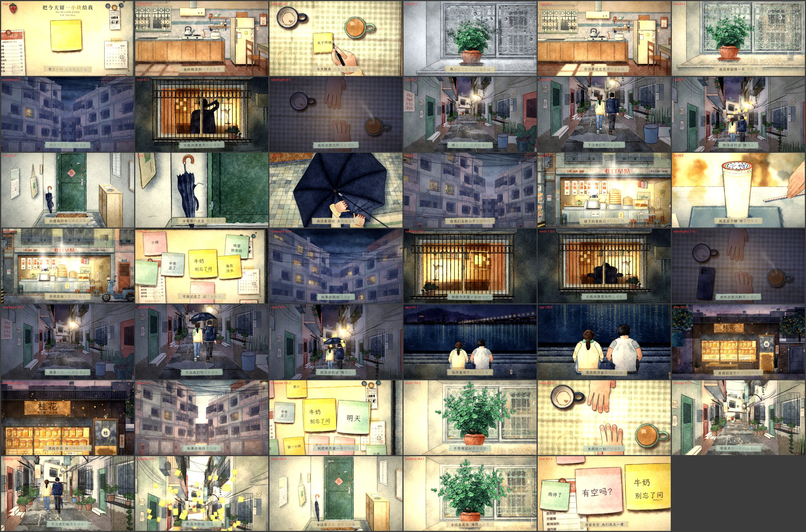

<div align="center">

# Save Me a Little of Today · Music Video

**A three-minute music video drawn entirely by code. No image or video generation models, no footage, no SVG.**

Python paints the watercolours. A web page animates them as a pure function of time. Headless Chrome captures every frame and ffmpeg adds the song.


</div>

## About

This is the music video for **Save Me a Little of Today** (《把今天留一小块给我》), written by Chan Meng and made with Suno: understated Taiwanese indie bedroom pop at about 78 BPM. The recording is the whole soundtrack and is not edited.

One ordinary stretch of days in an old Taipei lane. A sticky note on the fridge says *milk* and *don't forget to ask*. The mint on the sill grows a leaf nobody noticed. At night two windows across a lane are the only ones still lit. A borrowed umbrella with a bent rib waits by the door. The breakfast stall downstairs remembers *hot soy milk, less sugar, straw on the side*. The two of them walk down the lane as far as the bend, and every time they turn back. In the last chorus it is daylight after rain, and the camera finally goes round the corner.

Three threads run through the film:

1. **A small square of today.** The title asks for "一小块", a small piece of the day, and the film's shape is the small square: the sticky note, the square of sunlight crawling across the kitchen floor, one lit window in a dark block, the small square tiles of an old kitchen and an old facade, the washi tape the lyric is written on. On every "留一小块给我" a pen goes once round a small square in the frame. The things left unsaid become blank yellow notes that float up into the sky.
2. **Mint against grey.** The rain, the lane and the night are grey-blue and violet. The flat is warm paper, terracotta and pale tile. The one fresh colour belongs to the mint, which is a little bigger every time we see it. When she sings that she forgot when it turned green, the colour spreads out of the mint into a grey afternoon.
3. **Two people, no faces.** She wears a cream cardigan and a mint scarf, he a navy jacket. They are only ever backs, hands, two silhouettes in two windows, two mugs on a table.

The whole film on one sheet, one frame from each shot:



The finished MP4 is not in the tree (about 500 MB). Render it with the commands below.

## How it is made

The pipeline is the one built for [A Coffee for One](https://github.com/ChanMeng666/solo-coffee-mv), the same three steps as painting backgrounds, shooting them and printing the film.

### 1. Paint (Python, `films/today/paint/`)

`wc.py` is a small procedural watercolour engine built on numpy and OpenCV. A sheet stores absorbance per channel over a paper-white ground, so washes laid over each other mix subtractively, the way transparent pigment does. Each wash gets a wobbled outline, pigment pooled along its inside edge, granulation in the valleys of the paper tooth and slow backruns, with wet-in-wet bleed, dry brush and salt as options. Pen lines are stamped along a spline with pressure variation, a taper at both ends and a slight tremor. This film adds its own pigments: mint, sticky-note yellow, terracotta, old-facade tile green, soy, osmanthus, dusk violet, navy.

`kit.py` holds the drawing habits shared by every painting. Each `s_*.py` describes one set in code, splits it by depth and saves the layers as WebP. Several sets (the kitchen, the lane, the two blocks) are laid out through a real perspective camera in centimetres, so the page can put people and light into them at the right size.

| Set | Module | What is in it |
|---|---|---|
| Fridge | `s_fridge.py` | The fridge door close: a noodle-shop menu, a receipt, a calendar, magnets; the sticky notes in four colours; two hands |
| Kitchen | `s_kitchen.py` | A small old kitchen in morning sun, and the same room with its furniture cut out so sunlight can fall behind it |
| Table | `s_table.py` | The checked tablecloth from above: two mugs, a pad of notes, a pen, a phone face up and face down, hands |
| Sill | `s_sill.py` | The window and its iron grille in the rain, the street outside out of focus, the mint (young and grown), one new leaf |
| Entry | `s_entry.py` | The 玄关 with its green door; the umbrella loose and fastened; the umbrella opened on the floor and two wet hands |
| Block | `s_block.py` | Two walk-ups across a lane at night and at first light, every window dark and lit; one window close, with him at the desk |
| Lane | `s_lane.py` | The old lane bending at its halfway corner: dusk and day skies, walls, wet ground, scooter, shrine, lamp |
| Stall | `s_stall.py` | The breakfast stall in the morning; the soy milk cup, its straw and the boss's hand |
| Shop, step | `s_shop.py`, `s_step.py` | The osmanthus shop at blue hour; the river steps at night |
| People | `s_figure.py`, `s_props.py` | The two of them walking (dusk, under one umbrella, in daylight), sitting on the step, the jacket; small notes; washi tape |

### 2. Animate (browser, `films/today/*.js`)

The page exposes one function, `window.renderAt(t)`. Any frame is a pure function of `t`: no clock, no `Math.random`, nothing carried over from the previous frame, so frames render out of order and in parallel.

- **`stage.js`**: the multi-plane parallax camera, light, rain, steam, ripples, lines that draw themselves, handwriting written character by character, notes that float up, and window light projected onto a floor or wall quad.
- **`shots_*.js`**: 41 shots. A shot paints one frame into a 2D canvas and tells the post pass whether it is seen through wet glass and how to grade it.
- **`post.js`** (WebGL2): rain on glass as a height field, transitions that behave like paper and wet paint, grade, bloom, the paper's tooth. New for this film: the old picture **peels off like a sticky note** from a corner and shows the paper back, a **small square opens** onto the next shot, and a shot **closes into a small square** (a lit window across the lane).
- **`edit.js`**: the edit decision list. Shot boundaries come from the per-character lyric times.
- **`type.js`**: each lyric is written in ink on a strip of washi tape pressed onto the frame, mint tape for the choruses, and lights up character by character as it is sung.

### 3. Render (`harness/render.mjs`)

Three headless Chrome instances capture frames in parallel. ffmpeg encodes them and muxes the song.

## Timing

`tools/timing_all.sh` turns the recording into `films/today/timing.json`: faster-whisper (large-v3) for word times, `align.py` to match the known lyric sheet by pinyin, librosa for beats and loudness. All 46 sung lines aligned. Two corrections, both in the open:

- The lyric sheet has "如果你刚好也想起" twice in a row in the second chorus; the recording sings it once, so `lyrics.txt` has it once.
- The recogniser puts the first word at 0.00 s; the breath of "你" is at about 0.25 s (`tools/build_timing.py`).

## Rebuild

Requirements: Python 3.11+ with numpy, opencv-python and Pillow (timing also needs faster-whisper, librosa, pyloudnorm, soundfile, opencc, pypinyin); Node 20+, Google Chrome, ffmpeg. From the repository root, in a POSIX shell (Git Bash on Windows):

```sh
npm install
sh tools/timing_all.sh songs/today.mp3                      # timing.json from the recording
( cd films/today/paint && python build.py )                 # paint every layer into films/today/art/
node harness/render.mjs films/today --stills 5.2,52,140     # a few frames → films/today/out/stills/
python tools/shotsheet.py films/today sheet-test.jpg        # one frame from each shot
node harness/render.mjs films/today --workers 3 --audio songs/today.mp3 --crf 18 --tune grain --threads 12
python tools/qa.py films/today/out/video.mp4 films/today    # frozen stretches, jumps, motion per shot
```

To look at one shot alone, serve the repository root (`python -m http.server 8000`) and open `http://localhost:8000/films/today/index.html?shot=<id>&t=<seconds>`, with an id from `edit.js`.

## Layout

```
songs/                    the recording
tools/                    timing (transcribe, align, analyse), shot sheets, motion QA
harness/                  frame-by-frame renderer and a preview page
lib/                      timing helpers, easing, deterministic noise, font table
assets/fonts/             fonts (SIL OFL)
films/today/
  BIBLE.md                story, characters, palette, storyboard
  lyrics.txt  timing.json
  paint/                  the watercolour engine and how each set is painted (Python)
  art/                    the painted layers (WebP) and manifest.json
  index.html  film.js  edit.js  core.js  stage.js  post.js  type.js  shots_*.js
  poster.jpg  sheet.jpg
  CREDITS
```

## Credits

Song and lyrics by Chan Meng, made with Suno. Picture drawn in code with [Claude Code](https://claude.com/claude-code): the sets were painted by five Claude Code agents working in parallel from one film bible, and the finished cut was checked by two independent reviewer agents that saw only the rendered video.

Fonts (SIL OFL 1.1): LXGW WenKai, Noto Serif SC, Cormorant Garamond. Sources and adapted code are listed in [`films/today/CREDITS`](../films/today/CREDITS).
